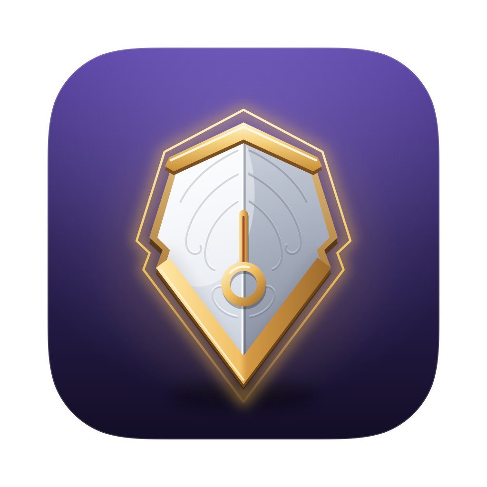

<p align="center">
  <picture>
    <source media="(prefers-color-scheme: dark)" srcset="crates/aegis/icons/icon-dark.svg">
    
  </picture>
</p>

<h1 align="center">Aegis</h1>

<p align="center">
  <b>An infinite canvas for your terminals and your AI coding agents.</b><br>
  <a href="#install">Install</a> · <a href="#quick-start">Quick start</a> · <a href="docs/guide.md">Guide</a> ·
  <a href="CONTRIBUTING.md">Contributing</a>
</p>

Aegis puts every terminal on one canvas you pan and zoom, like a whiteboard: place them anywhere, resize them,
group them by project. It is made for working with CLI agents such as Claude Code and Codex, side by side, wired to
each other and to the boards and notes they work from.

## What it does

- **Terminals on a canvas.** As many as you like, snapped to each other as you move them; pan, zoom, or fill the
  window with one block or a few tiled side by side.
- **A cockpit for AI agents.** Claude Code, Codex, Gemini CLI and 17 more open from a right-click, in the folder you
  pick. A dot on Claude Code's or Codex's title shows it working, or waiting for you.
- **Agents that work together.** Wire blocks with a cable: Claude Code, Codex, Gemini CLI and five more read and type
  into the terminals wired to them, work through a kanban's cards, hand tasks to each other and open new agents, in
  their own Git worktree if they want.
- **The Aegis Agent.** Ask "a workspace for ~/proj with a kanban of 4 cards and a Claude Code per card", and it
  builds it on the canvas for you to watch.
- **Your plan limits in sight.** A Claude Code or Codex terminal shows its context and cost; the title bar shows your
  plan's 5-hour and weekly limits and warns you before you reach them.
- **Workspaces.** One canvas per project. Agents keep running in the workspaces you aren't looking at.
- **Everything beside the terminal.** Kanban boards, Markdown notes, checklists, a code editor, a Git popup that
  writes commit messages with AI, and pens and shapes to draw on the canvas.
- **Kept as you left it.** Every workspace and block comes back when Aegis opens: terminals in their last folder,
  Claude Code, Codex and most other agents on their latest conversation.
- **Native and light.** Rust drawn on the GPU, no webview or Electron. macOS, Linux (Wayland and X11) and Windows.
  It follows your light or dark mode and takes any Alacritty theme.

## Install

Download the file for your system from the [latest release](https://github.com/jpcerchiari/Aegis/releases/latest):
the installer (`-setup.exe` or `.msi`) or the bare `.exe` on Windows, the `.dmg` on macOS (Apple Silicon or Intel),
the `.AppImage`, `.deb` or `.tar.gz` on Linux. From then on, Aegis updates itself.

The builds aren't signed by an Apple or Microsoft account, so a downloaded file asks once:

- **macOS:** open Aegis, choose *Done* when macOS says it can't verify it, then *System Settings ▸ Privacy &
  Security ▸ Open Anyway*. Or run `xattr -dr com.apple.quarantine /Applications/Aegis.app`.
- **Windows:** on the SmartScreen prompt, *More info ▸ Run anyway*.

### From source

With [rustup](https://rustup.rs) and the prerequisites in [CONTRIBUTING.md](CONTRIBUTING.md#setup):

```sh
git clone https://github.com/jpcerchiari/Aegis && cd Aegis && cargo run -p aegis
```

## Quick start

1. **Open Aegis.** The first time, a welcome lets you pick your theme, your shell and your AI agents.
2. **Open an agent.** Right-click the canvas, **AI agent ▸ Claude Code** (or any other), and pick its folder.
3. **Move around.** Drag the empty canvas or scroll to pan, Ctrl+scroll or pinch to zoom; drag a title bar to move
   a block, its bottom-right corner to resize it.
4. **Give it a board.** Ctrl+Shift+K adds a kanban block: create a board in it and write a few cards. Pick the
   cable in the toolbar and drag from the agent to the board to wire them, then ask the agent to work through the
   cards.
5. **Ask the Aegis Agent.** Ctrl+Shift+Space (Cmd+Shift+Space on macOS), and say what you want on the canvas.

The keys worth knowing (Cmd instead of Ctrl on macOS, and Cmd+T for a new terminal):

| Keys | Action |
|---|---|
| Ctrl+Shift+T | New terminal |
| Ctrl+Shift+K / Ctrl+Shift+M / Ctrl+Shift+E | New kanban board / note / editor |
| Ctrl+Shift+G | The Git popup |
| Ctrl+Shift+Enter | Fill the window with the block, and back |
| Ctrl+Shift+1 | Fit every block in view |
| Ctrl+Shift+O | Home |
| Ctrl+, | Settings |

Hold **Alt** (Option on macOS) to pan with a drag or zoom with the wheel anywhere, over blocks too.

## Learn more

- **[The guide](docs/guide.md):** every feature, every mouse action and shortcut, and `config.toml`.
- **[The specs](docs/specs/)**: how each part behaves, in detail. **[ARCHITECTURE.md](docs/ARCHITECTURE.md)** and
  the [decision records](docs/adr/) explain how Aegis is built: its terminals run on
  [`alacritty_terminal`](https://crates.io/crates/alacritty_terminal), its UI on [GPUI](https://www.gpui.rs), Zed's
  GPU framework, through [gpui-kit](https://github.com/longbridge/gpui-kit).

## Contributing

Contributions are welcome: read [CONTRIBUTING.md](CONTRIBUTING.md) and the [Code of Conduct](CODE_OF_CONDUCT.md).
Security issues: see [SECURITY.md](SECURITY.md).

## License

[MIT](LICENSE). You may use, modify and sell Aegis, as long as the copyright notice is kept.
